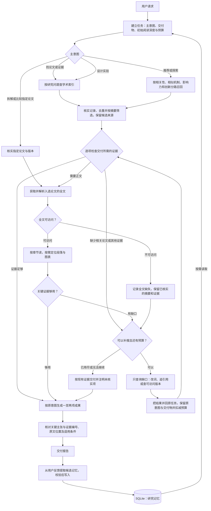

# paper-roam

A personal research assistant for discovering papers, exploring across fields, and tracing findings back to their sources.

## 第一阶段：摘要级论文推荐

需要 Python 3.10 或更新版本。命令行只使用 Python 标准库。
先在运行环境配置 `DEEPSEEK_API_KEY`。Windows 上也可以读取已配置的用户环境变量。
`OPENALEX_API_KEY` 可选。未配置时使用 OpenAlex 的免认证查询额度。

```powershell
python paper_roam.py "我想了解 AI 长期记忆"
```

程序先生成一组检索词，最多从 OpenAlex 取 10 条候选，再根据作者摘要推荐最多 3 篇。
候选类型为文章、综述和预印本，并排除索引标记为已撤稿的记录。
结果会显示实际检索词、文献链接、中文推荐理由和作者摘要中的原文依据。
程序从索引取出原文，模型根据所选片段写理由。可以对照原文检查理由是否成立。
链接优先使用索引记录中的 DOI，缺少 DOI 时使用 OpenAlex 记录链接。推荐范围限于摘要。
如果没有足够相关的候选，命令会如实说明。

先按主题召回，再综合年份和引用数排列候选。排序用（引用次数 + 1）除以从发表年份起算的年数，让引用积累时间更短的新论文也有机会靠前。报告显示索引给出的年份与引用次数。AI Attention 机制默认从 2017 年起（含 2017 年）。也可在输入里明确指定更晚的起始年，例如「只看 2023 年及以后」。

运行本地测试：

```powershell
python -m unittest discover -s tests -v
```

## 第二阶段：多路论文探索

```powershell
python paper_roam.py "我对 AI 长期记忆感兴趣。推荐三篇，至少一篇来自我不熟悉的领域。"
python paper_roam.py "我不知道今天该看什么论文"
```

- 直接相关：按主题搜。没有指定主题时，从不同学科组抽取四个学科起点，由模型为每路生成具体检索词。
- 相似机制：用其他学科的术语搜处理类似问题的论文。
- 跨领域影响力：先取与该路检索词相关的候选，再参考 OpenAlex 引用数。
- 跨领域创新：优先找近几个出版年度的论文，并从摘要指出具体方法或发现。这个标签用于发现候选，创新性仍需进一步核实。

默认最多推荐四篇，也可以要求一至四篇。报告会显示每篇的入选路线、索引学科、来源链接、推荐理由和摘要原文。跨领域要求以 OpenAlex 学科标签作近似判断，用户是否熟悉某一领域需要结合用户提供的信息。找不到合适的候选或某一路查询失败时，结果会标出缺口。

无主题探索给每路一个独立的研究问题，额外显示每路抽到的学科起点，并尽量选择 OpenAlex 学科标签不同的论文。重复提问时，学科组合和检索词可能变化。

## 项目目标

PaperRoam 在本地运行，用普通大模型 API 做语言判断和生成。它能从具体问题、模糊兴趣或指定论文出发，主动搜索学术来源，找到值得读的工作，并把关键结论追溯到实际阅读的论文。它也能记住研究进度和项目决定，接着上一次继续。

## V1 需求

| 用户想做什么 | 助手怎么处理 | 可交付成果 |
| --- | --- | --- |
| 带着具体问题找论文或证据 | 按问题搜候选。需要判断论文发现了什么时，再核对正文中的实验、结果与条件。 | 阅读清单或有证据的解答 |
| 探索领域或找值得读的论文 | 分别搜直接相关、相似机制、跨领域高影响力和跨领域创新的工作。用户没有主题时，从已有兴趣及陌生领域找不同入口。 | 阅读清单或方向地图 |
| 拆解或比较指定论文 | 按章节梳理研究缺口、作者动机、方法、对照、结果和局限。比较时核对数据、模型、基线与指标是否可比。 | 论文拆解或对照表 |
| 从文献走向实验 | 从实际论文中定位证据缺口，给出可检验的假设、对照、指标和改判条件。按问题选择模型与环境。 | 实验提案，可附论文拆解 |

- 每次交付一至两项成果，按本次意图决定。每篇推荐写明入选理由。跨领域推荐说明什么可以借用、什么需要重新验证。
- 粗略检索先看标题、作者摘要和元数据，以论文为单位筛选。细致检索按需取全文。拆单篇时按章节读，跨多篇定位证据时可用段落级召回与重排。
- 报告使用核实过的论文链接和版本。关键数据、实验条件和结论指向实际读到的章节、页码、图表或摘要。区分作者的主张、综合判断和待验证假设。证据不足时标出缺口。
- 长期记忆保存已确认的兴趣、偏好、已读论文、待追问题和项目决定。明确更新时保留历史并使用当前版本。随口表达的好奇可以留下探索线索，模型推测的偏好经用户确认后才生效。
- 本地程序执行学术查询、记忆读写和计算器等工具，处理超时、有限重试和停止。任务中断时可以交付已核实的结果并注明缺口。

## 主流程



补搜复用学术查询和原文获取工具。每次补搜只返回缺口对应的材料，由原任务决定接下来怎么交付。例如推荐三篇论文时，补查第三篇的创新依据，查到后继续完成原阅读清单。

## 实现分工

| 模块 | V1 做法 |
| --- | --- |
| 文献发现 | OpenAlex 作为主索引。按需用 Semantic Scholar 扩展相似论文和引用关系，用 Crossref 核对登记的 DOI 与元数据。推荐任务按各路标准筛选，再组装阅读列表。 |
| 原文与证据 | 按实际可用版本从 arXiv、出版页、开放仓储或用户提供的 PDF 取正文。证据记录包含编号、论文版本、原文摘录及位置。报告中的链接根据核实过的记录生成。 |
| 任务编排 | 普通模型 API 返回结构化的主意图、交付物、检索建议和证据缺口。本地程序校验结果、执行工具和限制重试。补搜期间保留已选论文、已有证据和剩余预算。 |
| 研究记忆 | SQLite 保存研究状态、来源与更新历史。当前项目决定按字段直接查，模糊的历史线索按需检索。论文和原文证据通过论文 ID 关联。 |
| 检索与重排 | 需要段落检索时，先用 BM25 建基线，再比较 Embedding、RRF 合并和重排。上下文构建由程序选择相关记忆、原文片段及出处，再交给模型。 |

## 验收

- **回答具体问题**：找到相关论文和正文证据，抽查关键结论及数字能否回到相应原文。全文无法获取时，如实交代证据边界。
- **探索新兴趣**：一句「我不知道看什么」能得到来源真实、方向有差异的阅读入口，每项有明确推荐理由。
- **补搜与恢复**：核实某篇论文的依据后，继续完成原交付物。工具超时或预算耗尽时，保留已核实结果并说明缺口。
- **检索增量**：固定问题集、论文集和生成模型，比较 BM25、混合检索与重排对前几名证据命中率、结论支持情况和耗时的影响。
- **记忆增量**：固定模型和文献流程，对比有无长期记忆时的正确率、Token 用量、延迟和费用。覆盖跨会话偏好、明确改口和缺少证据的情况。
